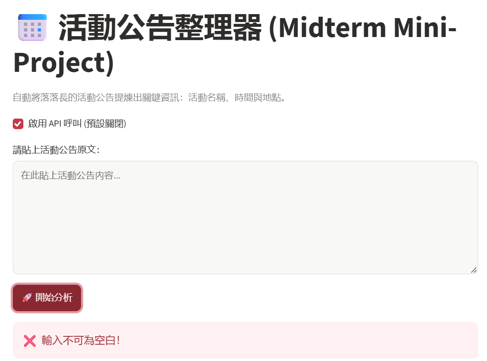
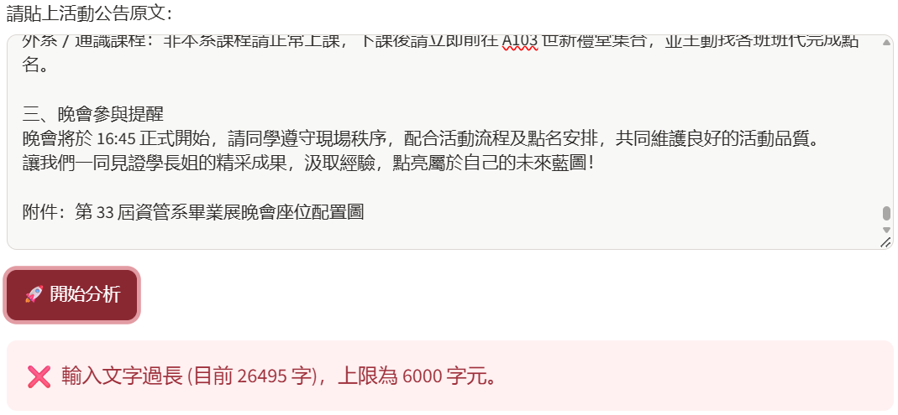
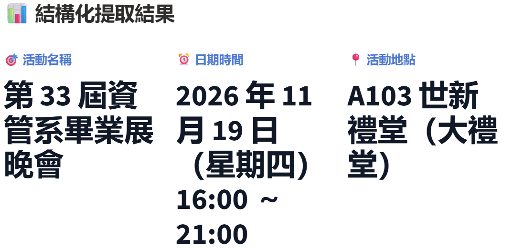
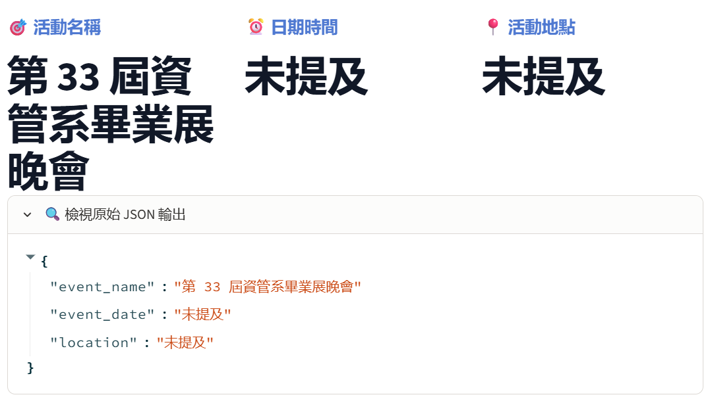

# 第 8 週｜個人專題設計與驗收紀錄
> 以下依目前專案程式與已知操作紀錄整理。尚未親自驗證或缺少證據的項目明確標為「待測／待補」；繳交前請補上作者資料、實際測試與 Cloud 驗收資訊。請勿填入真實金鑰或個資。

## 一、自己的問題與設計

| 項目 | 我的內容 |
|---|---|
| App 名稱／作者 | 活動公告整理器／作者：徐韶君 |
| 目標使用者與情境 | 需要快速掌握社團、校園或其他活動公告資訊的人 |
| 想完成的一個任務 | 從一段活動公告中整理活動名稱、日期時間及地點 |
| 輸入資料與範圍 | 使用者貼上的活動公告文字；空白輸入會拒絕，長度上限 6000 字元；測試請使用虛構資料 |
| 資訊不足如何處理 | 僅依據原文擷取；原文未提供的欄位填「未提及」，不得推測補造 |
| 採用 starter 或自行實作 | 由目前檔案可確認為活動公告整理器；是否從 starter 改造及作者實際修改範圍請自行確認 |
| 結構化輸出路線 | JSON Schema；三個欄位皆為必填字串，並禁止額外欄位 |
| 相較教師範例的個人設計 | 專注於活動公告的名稱、日期時間、地點；採三欄結果呈現，長文字可換行，並提供原始 JSON 檢視。請作者確認這是否符合自己的實際設計 |

## 二、輸出欄位契約

| 欄位名稱 | 型別／限制 | 用途 | 畫面標籤 | 如何查原文 |
|---|---|---|---|---|
| `event_name` | 必填字串；未提及時為「未提及」 | 確認活動主題 | 🎯 活動名稱 | 對照公告中的活動名稱；未寫明時確認是否顯示「未提及」 |
| `event_date` | 必填字串；未提及時為「未提及」 | 確認活動日期與時間 | ⏰ 日期時間 | 對照公告中的日期、起訖時間；未寫明時確認是否顯示「未提及」 |
| `location` | 必填字串；未提及時為「未提及」 | 確認活動地點 | 📍 活動地點 | 對照公告中的地址、教室或場地；未寫明時確認是否顯示「未提及」 |

Schema 設定 `additionalProperties: false`。目前程式解析 JSON 後沒有另外逐欄檢查欄位型別或完整性；若修改輸出欄位或限制，需同步更新 Schema、檢查邏輯、畫面及測試。

## 三、測試紀錄

| 項目 | 實際輸入／操作 | 實際輸出／錯誤 | 人工判讀與修正 | 證據類型 |
|---|---|---|---|---|
| 空白 |  | 顯示「輸入不可為空白！」 | 顯示預期提示；依程式流程，空白檢查在 API 呼叫之前，請求數為 0 | 操作截圖及程式流程 |
| 過長 |  | 輸入 26495 字元時顯示「輸入文字過長（目前 26495 字），上限為 6000 字元。」 | 顯示預期提示；依程式流程，長度檢查在 API 呼叫之前，請求數為 0。6001 字元邊界值尚未測 | 操作截圖及程式流程；邊界值未測 |
| 正常資料 |  | 畫面顯示成功；JSON 顯示活動名稱「第 33 屆資管系畢業展晚會」、日期時間「2026 年 11 月 19 日（星期四）16:00 ～ 21:00」、地點「A103 世新禮堂（大禮堂）」 | 使用者確認符合原始輸入；原始輸入未附於截圖，無法在此獨立逐字核對 | 使用者提供的操作畫面與核對結果 |
| 資訊不足 |  | 活動名稱為「第 33 屆資管系畢業展晚會」；日期時間及地點為「未提及」 | 畫面顯示缺少欄位未提及，未見補造資訊 | 操作截圖 |
| 結果保存／再送出失敗 | 尚未留下實際操作紀錄 | 未測；目前程式沒有明確以 `st.session_state` 保存結果 | 先成功再送出空白或過長內容，確認畫面不會保留舊結果造成誤認；保存行為待測，必要時補上狀態管理 | 程式碼檢視；操作未測 |
| 缺 key／服務失敗 | 尚未移除設定或刻意造成服務錯誤 | 程式有缺少金鑰提示及例外錯誤顯示；實際錯誤路徑未測 | 使用安全方式驗證缺少設定時會在請求前停止；不得在紀錄、畫面或截圖暴露金鑰 | 程式碼檢視；操作未測 |
| Cloud 部署（必做） | Cloud 曾出現 requirements 安裝失敗；改用 Repo 根目錄 `app.py` 後，使用者提供 Cloud 分析結果畫面 | Cloud 畫面顯示活動名稱「AI 應用講座」、日期時間「2026/11/25 14:00-16:00」、地點「公院二樓 M201 國際會議廳」 | 使用者記錄模型為 `gpt-4o-mini`、請求數 1，並確認欄位正確；作者另確認新版 Cloud 網址可開啟及 GitHub Repo 已公開。老師本人是否已開啟仍未確認 | Cloud 操作畫面及使用者提供的測試紀錄 |

### 真實 API 測試補記

| 截圖 | 執行位置 | 模型 | 虛構輸入原文 | 實際輸出／JSON | 人工核對 | 請求數 |
|---|---|---|---|---|---|---|
|  | Cloud | `gpt-4o-mini` | 📢【AI 應用講座】邀請到業界專家分享最新 Generative AI 趨勢！⏰ 時間：2026/11/25 14:00-16:00📍 地點：公院二樓 M201 國際會議廳 | `{"event_name":"AI 應用講座","event_date":"2026/11/25 14:00-16:00","location":"公院二樓 M201 國際會議廳"}` | 使用者確認三欄皆正確、無造假；原文與結果相符 | 1 |

正常資料與資訊不足測試的截圖顯示了結果，但未附各自完整原文、模型與請求數；請勿把它們與上方已記錄輸入及請求數的 Cloud 測試混為同一筆。空白與 26495 字元測試依程式的前置檢查流程均不會呼叫 API，故各為 0 次請求。

## 四、環境、交付與反思

- 本機檢查環境：Python 3.14.3、Streamlit 1.67.0、OpenAI SDK 3.46.0、python-dotenv 1.2.4、Pydantic 2.14.3。這是當時執行檢查的環境版本；部署環境版本需另查。
- GitHub：<https://github.com/a113223005/115_1_GenAI-App-Development>
- 分支：`main`
- 本機啟動方式：`python -m streamlit run app.py`（在專案資料夾內執行）
- Cloud 部署入口：Repo 根目錄 `app.py`；期中資料夾內另有 `Midterm Mini-Project/app.py`
- Cloud 網址：<https://1151genai-app-development-khfgtswshy6cjn39j38frn.streamlit.app/>（作者已確認新連結可開啟）
- Cloud Python 版本：曾設定為 3.14；目前部署實際使用版本待確認
- GitHub Repo 權限：作者已確認 Repo 設為 Public
- 老師觀看權限：Cloud 連結可開啟且 Repo 為公開；老師本人是否已開啟確認待補
- Cloud 驗收日期：待補；已有一筆 Cloud 真實 API 成功結果，作者已確認新部署連結可開啟
- 本紀錄可確認的 Cloud 真實 API 請求數：1；空白及 26495 字元輸入各 0 次（依程式前置檢查流程）；其他結果截圖的請求數未提供。追加測試數：待補
- 尚未完成的驗證：6001 字元邊界值、錯誤後舊結果處理、老師本人觀看確認，以及其他結果截圖的請求數
- AI 協助內容：協助整理 README、調整長日期顯示及撰寫本驗收紀錄；作者需確認程式內容、補做測試並核對紀錄後再繳交
- 已知限制與下一步：模型輸出仍須人工對照原文；目前沒有明確結果保存狀態。先完成 6001 字元邊界值及錯誤後舊結果檢查，並請老師確認可開啟 Cloud App
